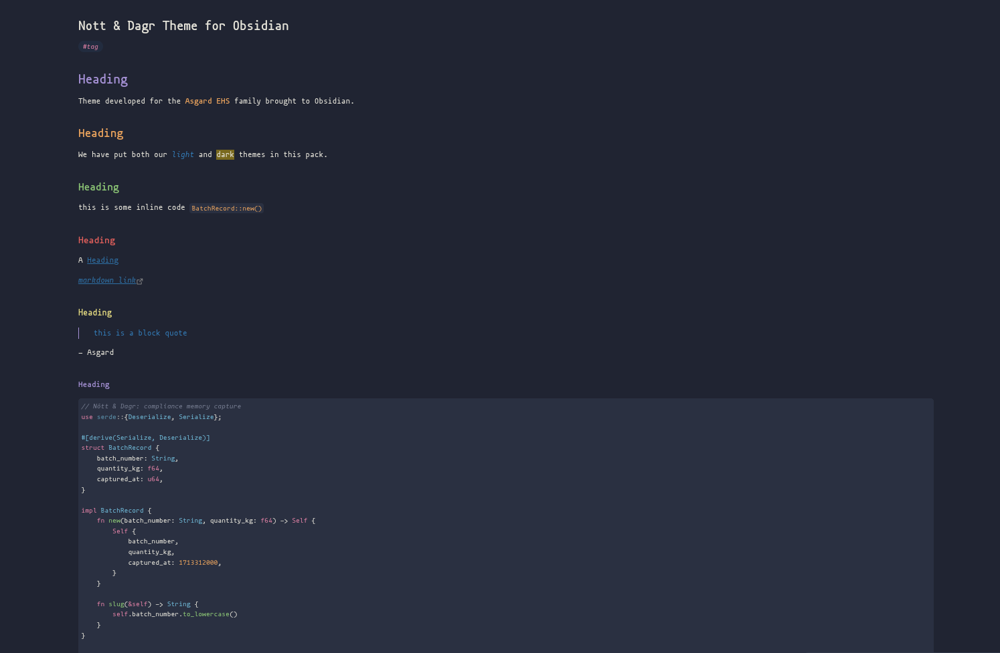
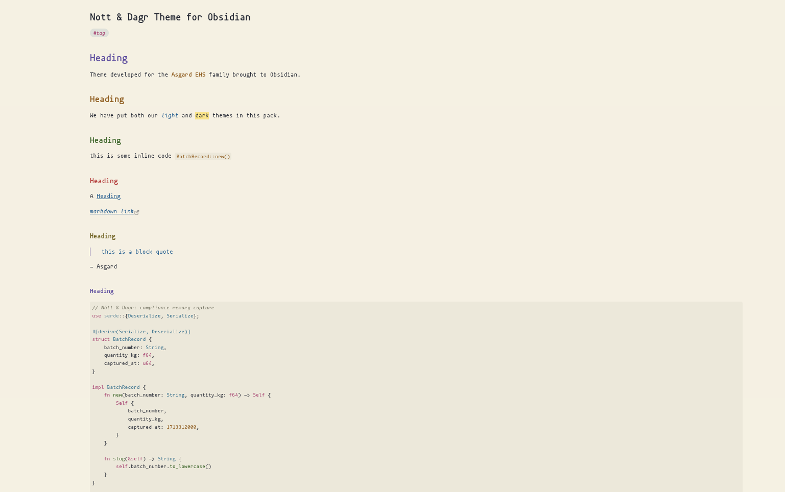

# Nótt & Dagr — Obsidian Theme

Paired dark and light themes for [Obsidian](https://obsidian.md), part of the
Asgard EHS ecosystem. **Nótt** (Norse for *Night*) is the dark variant; **Dagr**
(Norse for *Day*, son of Nótt) is the light variant. Both share the same role
architecture, so a keyword is the same *kind* of thing in either mode — only the
surface-adapted color shifts.

| Nótt (dark) | Dagr (light) |
|:-:|:-:|
|  |  |

## Design intent

- **Nótt** — aurora over a night sky. Cool petrol-slate ground with desaturated
  accents tuned for editor backgrounds.
- **Dagr** — morning light on parchment. Warm cream ground with deepened,
  earthier counterparts of the same accent roles.
- **Cross-theme parity.** Same semantic mapping in both modes. If `self` is
  Purple in Nótt, it is Purple in Dagr.

## Installation

### Community themes (once published)

1. Open Obsidian **Settings → Appearance → Themes → Manage**
2. Search for **Nott Dagr**
3. Click **Install and use**

### Manual install

1. Download `manifest.json` and `theme.css` from the
   [latest release](https://github.com/asgardehs/nott-dagr-obsidian/releases)
2. Place them in your vault under `.obsidian/themes/Nott Dagr/`
3. In Obsidian: **Settings → Appearance → Themes** → select **Nott Dagr**

To switch between modes, toggle **Settings → Appearance → Base color scheme**
between *Dark* (→ Nótt) and *Light* (→ Dagr).

## Palette

### Nótt (dark)

| Role        | Hex       | Used for                       |
| ----------- | --------- | ------------------------------ |
| Background  | `#1A1F2E` | Editor surface                 |
| Foreground  | `#E6E4DA` | Default text                   |
| Comment     | `#757C90` | Comments, disabled code        |
| Red         | `#E35F5B` | Errors, deletions              |
| Orange      | `#E8A25C` | Numbers, constants, inline code|
| Yellow      | `#E6DC82` | Strings, highlights            |
| Green       | `#8DC776` | Functions, methods             |
| Cyan        | `#6EB8D6` | Classes, types, links          |
| Purple      | `#A692D6` | `self` / `this`, headings (H1) |
| Pink        | `#DE80A4` | Keywords, tags, anchors        |

### Dagr (light)

| Role        | Hex       | Used for                       |
| ----------- | --------- | ------------------------------ |
| Background  | `#F5F1E4` | Editor surface                 |
| Foreground  | `#1F2330` | Default text                   |
| Comment     | `#6B6A58` | Comments, disabled code        |
| Red         | `#B53D3A` | Errors, deletions              |
| Orange      | `#8F5C18` | Numbers, constants, inline code|
| Yellow      | `#6E601A` | Strings                        |
| Green       | `#3A6525` | Functions, methods             |
| Cyan        | `#2B6A8A` | Classes, types, links          |
| Purple      | `#5B4A9E` | `self` / `this`, headings (H1) |
| Pink        | `#A84272` | Keywords, tags, anchors        |

The full color specification (palettes, ANSI mappings, UI surfaces, syntax
classification rules, accessibility notes) is maintained in the canonical
Asgard EHS theme spec.

## Development

Edits to `theme.css` are picked up by Obsidian after a reload (toggle the theme
or `Settings → Appearance → ↻` next to the theme dropdown).

To work on the theme against a vault, symlink the repo into
`.obsidian/themes/Nott Dagr/`:

```sh
ln -s /path/to/nott_dagr_obsidian /path/to/vault/.obsidian/themes/"Nott Dagr"
```

## Attribution

The role architecture, token classification, and specification structure follow
conventions established by the [Dracula Theme specification](https://draculatheme.com/spec)
by Zeno Rocha and Lucas de França. The Dracula spec is a functional framework
for describing syntax-highlighting themes; this theme reuses that framework.

All color values, theme names (Nótt, Dagr), design decisions, and accompanying
assets are original to the Asgard EHS project and are not derived from
Dracula's palette.

## License

Apache License 2.0 — see [LICENSE](LICENSE).

---

*Part of the Asgard EHS ecosystem.*
